# TvSat 0.6.3 — skórka Enigma2 dla OpenATV

Ciemny interfejs Full HD 1920×1080 inspirowany polskim CANAL+: białe napisy,
zielone zaznaczenie, duże menu, pikony, bukiety i program TV. Projekt niezależny,
bez oficjalnych logotypów i grafik operatora.

**Baza: natywne ekrany i komponenty OpenATV 7.5 / 7.6 / 8.0.** Wersja 0.6.3 zastępuje
wstępną bazę OpenPLi z 0.1.0. Sprawdzono kontrakty widgetów trzech wersji OpenATV,
układy, grafiki, menu, paczki i instalator. **Test na fizycznym dekoderze jest
jeszcze wymagany** — nie deklarujemy potwierdzonej zgodności sprzętowej.

## TvSat 0.6.3 — długie przejście fade

W Informacjach o audycji fade przechodzi teraz łagodnie **od lewej do prawej
przez około 95% szerokości ekranu**. Zamiast krótkich, symetrycznych przejść
na brzegach jest jeden szeroki gradient: mocniejsze przyciemnienie z lewej,
większa przezroczystość w prawej części. Kolor tła pozostaje #0c0e10.

Przyciemnienie zmienia się od około 94% do 72% krycia, aby zachować czytelność
białych, szarych i zielonych napisów również na jasnym obrazie. Marginesy 128 px,
czcionki i przewijanie opisu pozostają takie jak w 0.6.2. Zmiana obejmuje oba
rozmiary interfejsu; pasek kanału zachowuje swoje 15% przezroczystości.

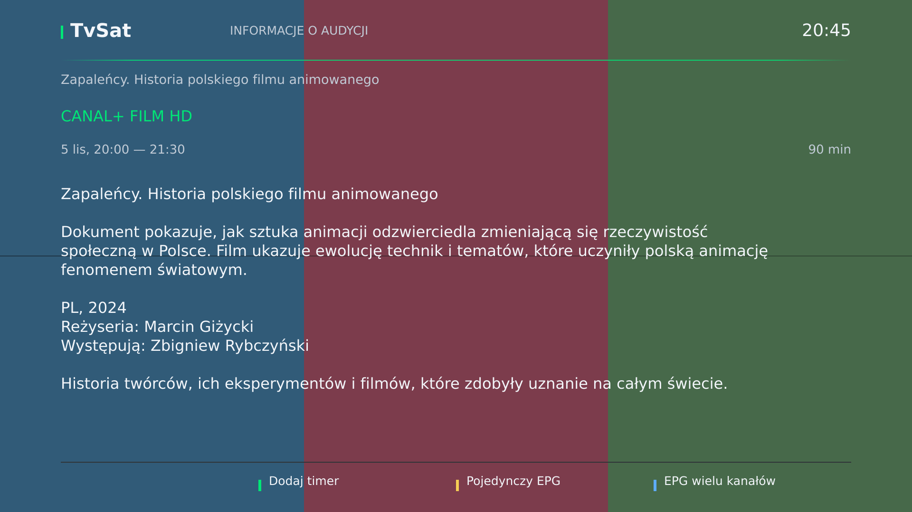
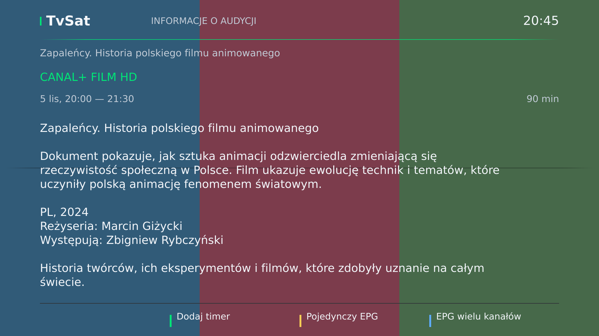

Po aktualizacji wykonaj restart GUI.

## TvSat 0.6.2 — równe marginesy informacji o audycji

Ekrany Informacje o audycji mają teraz **po 128 px marginesu z lewej i prawej**
(zamiast 64 px), zarówno w Standard, jak i Duże napisy. Do jednej siatki dopasowano
nagłówek, tytuł, kanał, opis, zegar, czas trwania i dolne przyciski.
Opis ma szerokość 1664 px i wcześniej zawija długie wiersze; nadal przewija się
natywnie. Boczne przejście fade kończy się przed obszarem tekstu.

Po aktualizacji wykonaj restart GUI.


## TvSat 0.6.1 — margines przy pikonie i fade opisu audycji

Zwiększono odstęp po obu stronach pionowej linii w pasku kanału. Od pikony
pozostaje 36 px, od początku nazwy kanału około 40 px. Podświetlenie TERAZ ma
własny większy margines; godziny, tytuły i postęp są nadal wyrównane.

Ekrany **Informacje o audycji** mają teraz ciemną, lekko przezroczystą powierzchnię
z efektem fade na bocznych marginesach. W polu napisów pozostaje około
85% krycia / 15% przezroczystości. Pełny opis nadal przewija się natywnie.
Zmiana dotyczy Standard oraz Duże napisy. Po aktualizacji wykonaj restart GUI.

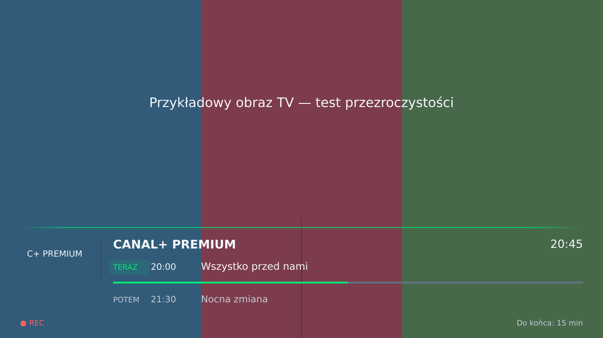


## TvSat 0.6.0 — Fade i nowocześniejsze detale

Pasek informacji płynnie łączy się z obrazem telewizyjnym: jego górna krawędź
ma **64 px przejścia fade**, od przezroczystości do ciemnego tła. W całym obszarze
napisów pozostaje około **85% krycia / 15% przezroczystości**. Pikona nadal leży
na tym samym tle co reszta paska.

- Zielona linia ma wygaszone końce i subtelną poświatę.
- TERAZ ma delikatne, zaokrąglone podświetlenie.
- Nazwa kanału używa mocniejszej czcionki, a cienki separator porządkuje pole pikony.
- Nagłówki menu mają spójny zielony znak i linię z efektem fade.
- Efekt obejmuje InfoBar, dodatkowy pasek i odtwarzacz, w Standard i Duże napisy.

Fade ma postać gradientu tła. Sposób pojawiania się okna nadal wynika z ustawień
OpenATV. Grafiki są statyczne i skalowane natywnie; nie wymagają dodatkowej
pętli animacji ani rozmywania obrazu na żywo. Po aktualizacji wykonaj restart GUI.


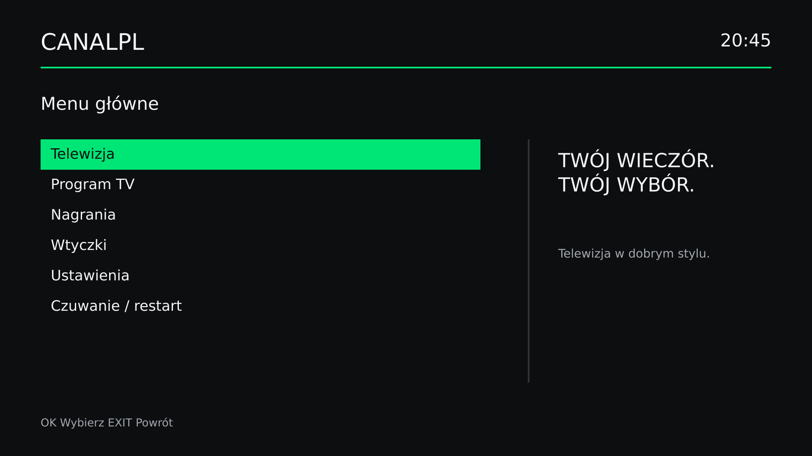

## TvSat 0.5.0 — siedem poprawek UI i UX

1. **Lista kanałów:** Standard ma siedem pełnych wierszy i stałe pola numeru,
   pikony, kanału, audycji oraz postępu. Długie nazwy mają wielokropek. Szablon
   obejmuje zarówno kanały w bukiecie, jak i tryb wszystkich usług.
2. **Panel audycji:** nazwa i opis dotyczą zaznaczonego kanału. Podgląd TV pokazuje
   oglądany kanał. Opis mieści pełne linie i kończy się wielokropkiem, gdy brak
   miejsca; INFO nadal otwiera pełną treść. Dodano postęp i czas do końca audycji.
3. **Pasek kanału:** wspólne tło pod pikoną, wyrównane godziny i tytuły, czytelny
   postęp, rzeczywisty licznik pozostałych minut oraz wskaźnik nagrywania.
   Timeshift ma wyraźnie nazwane, natywne okno stanu. Zachowano **15% przezroczystości**.
4. **Pilot:** wspólny kolor zaznaczenia, spójny wygląd przycisków i ukrywanie
   pustych akcji. Obsługa OK/EXIT pozostaje natywna. Nowy ekran wyglądu ma
   jednoznaczne Zapisz/Anuluj, a restart następuje dopiero po wyborze widza.
5. **EPG:** osobne tło aktualnych audycji, linia bieżącego czasu, różne ikony
   timerów i czytelny ekran konfliktu nagrań. Dane o timerach i konfliktach
   pochodzą z OpenATV; skórka nie zmienia logiki nagrywania.
6. **Dwa rozmiary:** TvSat Standard i **TvSatLarge / Duże napisy**. Wariant duży
   ma większe fonty całego interfejsu, większe odstępy i sześć wierszy kanałów.
7. **Komunikaty:** osobne widoki trwającej instalacji, wyniku i błędu, czytelne
   podpowiedzi dziennika, poprawiony dialog konfliktów oraz komunikat sukcesu
   z numerem wersji. Wynik operacji zawsze pochodzi z instalatora systemowego.

### Jak włączyć nowy układ

Po instalacji zrestartuj GUI, aby załadować nową wtyczkę. Otwórz:
**Wtyczki → TvSat — wygląd → Standard lub Duże napisy → Zapisz**.
Następnie potwierdź restart GUI. Zapisanie ustawia również odpowiedni szablon
listy kanałów i włącza pikony. Anulowanie nie zmienia ustawień.
Samo wybranie TvSatLarge w systemowym wyborze skórek zmienia wygląd, lecz nie
zastępuje wcześniejszych preferencji listy kanałów — zalecamy ekran TvSat — wygląd.

Wspieramy również starszy mechanizm listy: Standard ustawia tam osiem wierszy
(minimum dozwolone przez OpenATV), a Duże napisy sześć wierszy w dwóch liniach.
Zalecany nowy szablon ma odpowiednio siedem i sześć wierszy, jak na podglądach.
Nie są zmieniane bukiety, dane kanałów ani timery.

### Wizualizacje 0.5.0

To podglądy generowane ze współrzędnych XML i danych przykładowych, nie zrzuty
z odbiornika. Pikony są tekstowymi próbkami; na dekoderze używana jest Twoja
paczka pikonów. Pole TV jest symboliczne. Rendering fontów zależy od Enigma2.

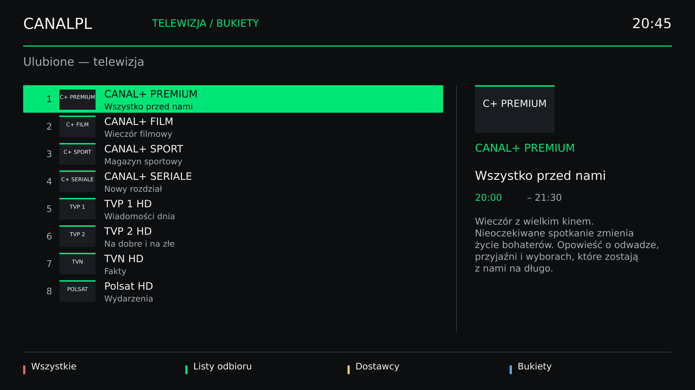
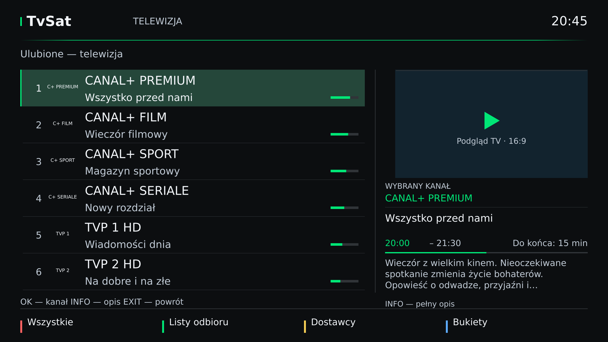

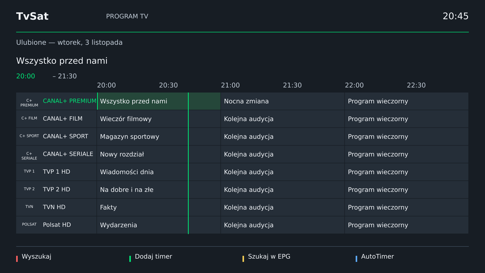
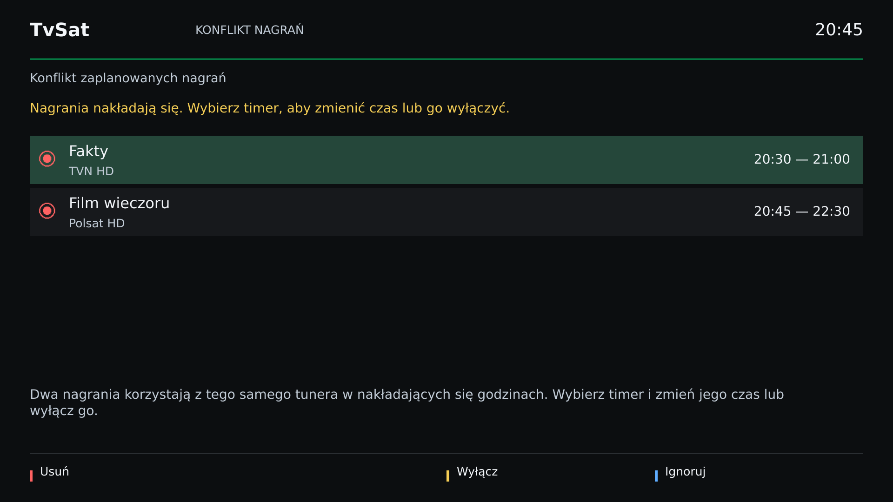
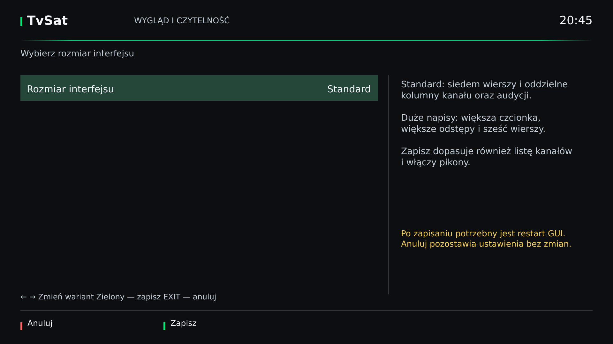
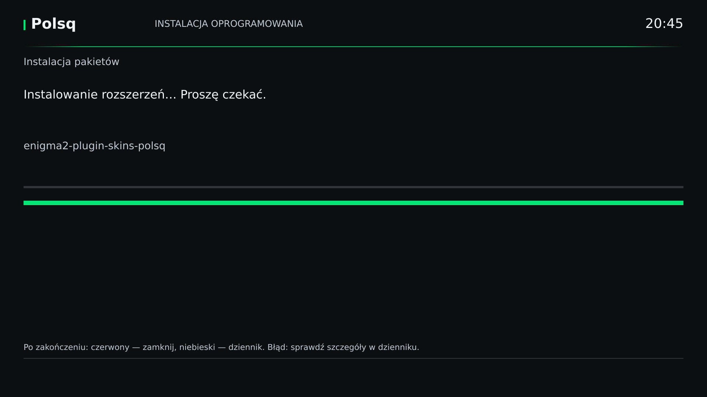
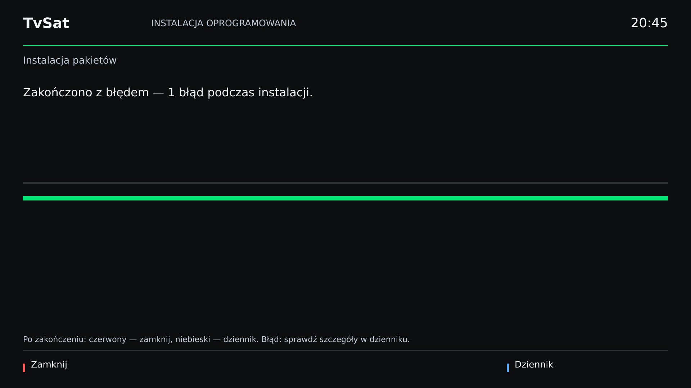

Pakiet zawiera dwie skórki, pasywną wtyczkę ustawień i dwa własne moduły
wyświetlania. Nie podmienia plików Pythona OpenATV. Instalacja nie uruchamia
wtyczki i nie zmienia ustawień — profil stosuje dopiero przycisk Zapisz.

## Poprawki 0.4.5 — przezroczystość 15%

Pasek kanału, dodatkowy pasek i pasek odtwarzacza mają około **15%
przezroczystości i 85% krycia** (`#260c0e10`, dokładnie 38/255 = 14,90%).
To korekta 9% z 0.4.4. Przywrócone pierwotne ciemne kolory, tło pod pikonami,
czcionki i układy pozostają bez zmian. Menu są nieprzezroczyste.

Po instalacji sprawdź komunikat **Wersja: 0.4.5** i wykonaj restart GUI.

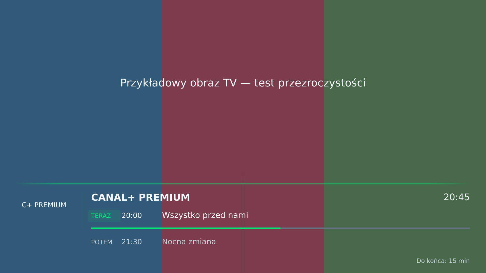

## Poprawki 0.4.4 — powrót do pierwotnego tła

Przywrócono ciemne tło pierwszej wersji: **#0c0e10** w całym interfejsie,
**#17191c** na panelach i **#303438** na liniach podziału. Tych samych
kolorów używają grafiki i karty wtyczek. Układy i czcionki pozostają dopracowane.

Pasek kanału, dodatkowy pasek i pasek odtwarzacza mają ponownie pierwotny
kolor Enigma2 **#180c0e10**: około **9% przezroczystości / 91% krycia**, zamiast
40% przezroczystości z 0.4.2–0.4.3. Tło pod pikoną jest wspólne z całym
paskiem. Menu pozostają nieprzezroczyste. Źródło kolorów: pierwsza wersja
[CanalPL, commit 9ce5d21](https://github.com/Baniak88/enigma2-skin/blob/9ce5d21c37bf031c92dbf4ef6adf2ef461e3dcc9/CanalPL/skin.xml).

Po instalacji sprawdź komunikat **Wersja: 0.4.4** i wykonaj restart GUI.


## Poprawki 0.4.3 — ustawienia skórki

Ekran wyboru skórki ma osobny układ Full HD: dziewięć pełnych wierszy,
jednakowe czcionki nazw i wartości (30 px), miniaturę 16:9 oraz wydzielone
miejsce na opis i informację o restarcie. Przyciski Anuluj i Zapisz pasują do
pozostałych ekranów TvSat. Nie zmieniamy ustawień użytkownika.

Definicje `SkinSelection`, `setup_Skin` i `SetupSkin` odpowiadają kolejności
wyszukiwania w natywnym Setup. Ogólny ekran Setup nie wystarcza, gdy
OpenATV znajduje wcześniej bardziej szczegółową definicję.

Nowy test wykonuje oryginalną logikę wyboru ekranu oraz ładowanie i ukrywanie
miniatury z przypiętych źródeł OpenATV 7.5 / 7.6 / 8.0, z zastąpionym C++.
Pozostaje test na fizycznym dekoderze. Po instalacji sprawdź komunikat
**Wersja: 0.4.3** i uruchom ponownie GUI.

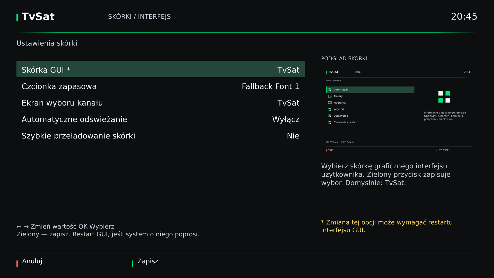

## Poprawki 0.4.2 — przezroczysty pasek, wtyczki i opis audycji

- Pasek wraca do ciemnego koloru i ma **40% przezroczystości**: obraz telewizyjny
  prześwituje przez jego tło, także pod pikoną. Kolor Enigma2 to `#660c0e10`
  (60% krycia). InfoBar, SecondInfoBar i pasek odtwarzacza używają tej powierzchni.
  Pełnoekranowe menu zachowują własne tło.
- Siatka wtyczek ma **cztery kolumny i trzy pełne wiersze**, większe ikony,
  spokojne karty i zieloną ramkę zaznaczenia. Dłuższe nazwy mają dwie linie.
- Pod podglądem kanału jest więcej miejsca na opis audycji (116 px) i odstęp
  od podpowiedzi INFO. Pełną treść nadal otwiera przycisk INFO.
- Instalator pokazuje numer wersji. Po aktualizacji w komunikacie powinno być
  **Wersja: 0.4.2**. Numer jest też w `/usr/share/enigma2/TvSat/VERSION`.
  Po instalacji wykonaj restart GUI; paczka zawiera poprawki FileCommandera z 0.4.1.

Podgląd przezroczystości używa kolorowego obrazu testowego. Pasy celowo biegną
również pod paskiem — to ilustracja mieszania obrazu, nie dodatkowa grafika skórki.
Ikony i nazwy wtyczek na podglądzie są przykładowe; na dekoderze pochodzą z wtyczek.


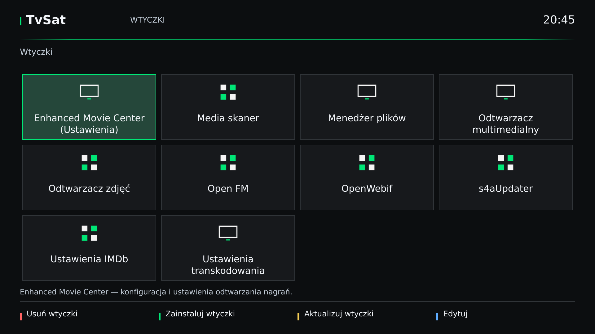


## FileCommander 0.4.1 — menedżer plików

- Dwa równe panele z ośmioma pełnymi wierszami, nazwami plików 28 px i czytelnym
  zaznaczeniem aktywnego panelu. Natywne przełączanie lewo/prawo pozostaje zachowane.
- Ścieżki, rozmiary, uprawnienia i daty korzystają z uporządkowanych nagłówków
  zamiast małych żółtych napisów. Font i geometria FileList są ustawione w jego
  własnych aliasach i parametrach, także dla trybu zaznaczania wielu plików.
- Menu operacji, informacje o pliku, podgląd zawartości i edytor pasują do TvSat.
  Podgląd/edytor zachowują krój o stałej szerokości znaków, dostarczany przez OpenATV.
- Komunikaty operacji nie zasłaniają list. MENU, INFO i HELP mają osobny rząd,
  a kolorowe funkcje są wyświetlane wtedy, gdy udostępni je menedżer plików.

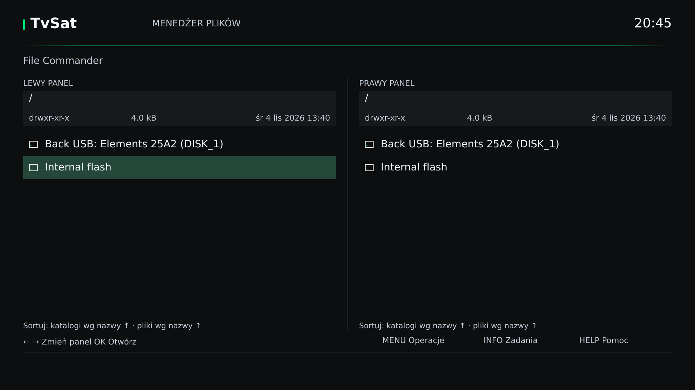
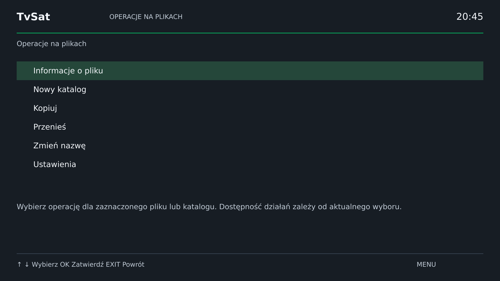

## Interfejs 0.4.0 — jaśniejszy pasek i spójna instalacja

- Wyraźnie jaśniejszy pasek **#3b4654**, ze wspólnym tłem pod przezroczystymi
  pikonami i lepiej widocznym torem postępu. Rozjaśniono również główne menu,
  ustawienia, listy kanałów i EPG; zaznaczenie pozostaje spokojnym ciemnym zielonym.
- Pełnoekranowy **IpkgInstaller** dla OpenATV 8.0: czytelne nazwy plików,
  własne pola zaznaczenia, osiem wierszy i podpisy przycisków w stopce.
- **Opkg** pokazuje rzeczywisty status, postęp, wynik i przełączany dziennik.
  Wynik błędnej operacji pozostaje błędem; skórka nie zastępuje go etykietą sukcesu.
- Dopasowano pobieranie i usuwanie pakietów (**PackageAction/PluginAction**),
  ich dzienniki i konsolę wykonywania poleceń.
- **Processing** ma kompaktową kartę nad pozostałymi ekranami: cienki pasek
  postępu i opis poniżej. Układ uwzględnia zmianę rozmiaru opisu przez OpenATV.
- Puste funkcje klawiszy nie zostawiają samotnych kolorowych znaczników.
  Wspólne paski przewijania są węższe; zwykłe listy i etykiety mają spójny krój.

Podglądy mają przykładowe dane; nie są zdjęciami z tunera:

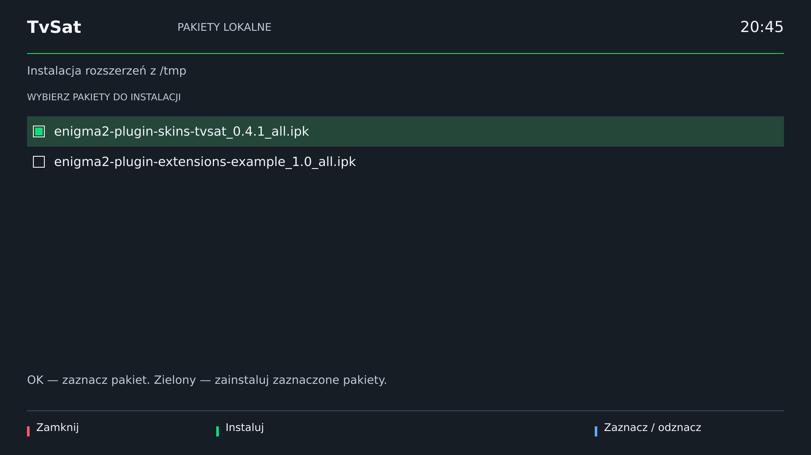
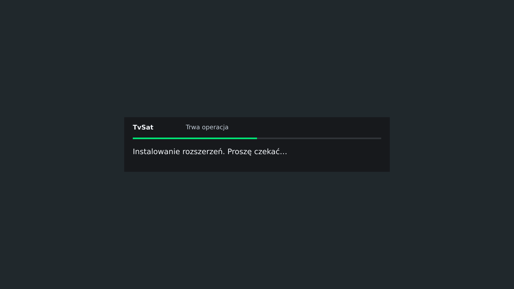

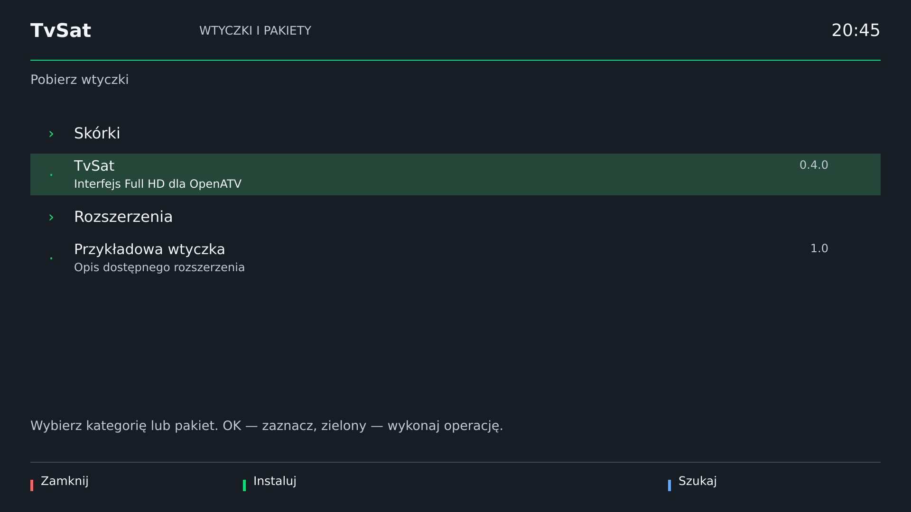

## Poprawki 0.3.3 — czcionki, pasek i instalacja

- Nazwy oraz wartości ustawień korzystają z DejaVu Sans Regular 30 px.
  Ustawiono osobny `valueFont` komponentu ConfigList i domyślne fonty konfiguracji.
- Lista ustawień ma dziesięć pełnych wierszy po 64 px i szersze miejsce na wartości.
  Opis po prawej ma font 28 px, a na dole jest podpowiedź nawigacji.
- Pasek informacji jest lekko jaśniejszy (`#21262c`). Pole pikony i obraz
  zastępczy są przezroczyste, więc nie tworzą osobnego prostokąta.
- Instalacja `.ipk` kończy się komunikatem **TvSat — INSTALACJA ZAKOŃCZONA
  POMYŚLNIE** i przypomnieniem o restarcie GUI. Komunikat drukuje skrypt
  `postinst` wykonywany przez opkg. Instalator ręczny wyświetla ten sam komunikat.
  W systemowym instalatorze treść może być widoczna w jego oknie lub logu.

Jeśli sama pikona PNG ma zapisane nieprzezroczyste tło, pozostanie ono częścią
tego obrazka. Skórka usuwa własne tło; logotypów z Twojej paczki nie zmienia.

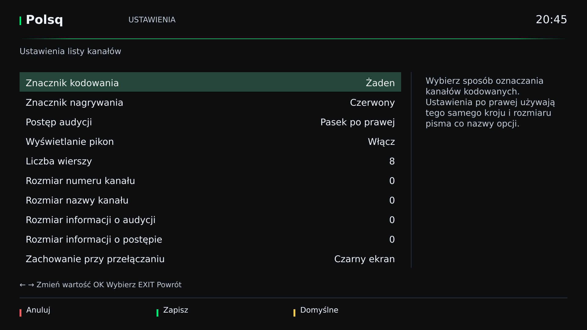

## TvSat — nowa nazwa i miniaturka (0.3.2)

Skórka, nagłówki, style ekranu i szablon listy mają nazwę **TvSat**.
Miniaturka `TvSat/prev.png` jest wyświetlana przez natywny wybór skórek OpenATV.
Przedstawia układ menu z przykładowymi danymi, bez obrazu z tunera.

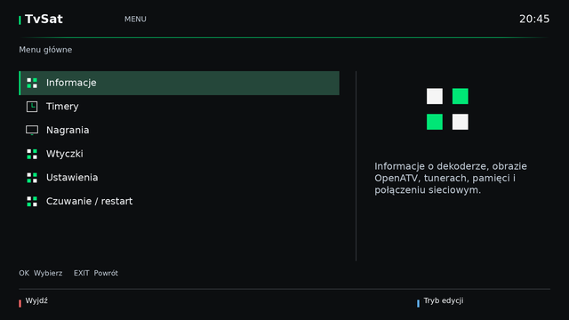

TvSat instaluje się do osobnego katalogu `/usr/share/enigma2/TvSat` i używa paczki
`enigma2-plugin-skins-tvsat`. Wcześniej zainstalowana skórka CanalPL pozostaje
na dekoderze. Po instalacji wybierz **TvSat** w wyborze skórek i zrestartuj GUI.
W ustawieniach listy kanałów wybierz ponownie styl **TvSat — podgląd TV**
i szablon **TvSat**, jeśli poprzednio były ustawione warianty CanalPL.

## Układ listy kanałów — 0.3.0

- Domyślna lista oraz wariant `ChannelSelection_PIG` mają podgląd TV 640×360,
  czyli 16:9. Natywny renderer `Pig` pokazuje aktualnie odtwarzany kanał.
- Opis zaznaczonej audycji znajduje się pod podglądem. Nie trzeba zasłaniać go
  pełnym tekstem; klawisz INFO otwiera pełny opis.
- Czcionka interfejsu to DejaVu Sans Regular (`TvSatText`), z osobnym krojem
  dla mocniejszych nagłówków. Oba pliki fontów dostarcza OpenATV.
- Zaznaczenie jest ciemnozielone z białym tekstem i zielonym paskiem w szablonie
  TvSat. Nazwa kanału i tytuł audycji są w oddzielnych liniach.
- Dostępny jest także wariant **TvSat — bez podglądu**.

**Aby uzyskać osiem wierszy jak na podglądzie:** w ustawieniach listy kanałów
wybierz styl ekranu **TvSat — podgląd TV** (lub **TvSat — standard z TV**)
i szablon listy **TvSat**. Włącz pikony listy i zatwierdź zmiany.
W liście kanałów menu ustawień otwierasz klawiszem MENU; nazwy pozycji zależą
od tłumaczenia OpenATV. Po aktualizacji skórki wykonaj restart GUI.

Tryb **Legacy** nadal korzysta z ustawionej w OpenATV liczby wierszy i sposobu
wyświetlania informacji. Skórka poprawia w nim fonty, kontrast i podgląd, ale nie
nadpisuje preferencji użytkownika. Jeżeli chcesz zachować Legacy, wybierz w jego
ustawieniach osiem wierszy, dwie linie i zerowe korekty rozmiaru czcionek.

Podgląd TV pokazuje kanał oglądany; przesuwanie kursora zmienia opis zaznaczonej
audycji. Przełączanie obrazu odbywa się standardowymi klawiszami OpenATV.
Obsługa podglądu zależy od sterownika wideo urządzenia. Wariant bez podglądu
pozostawia pełny panel informacji.

## Poprawki 0.3.1 — pikony i niebieski przycisk

- Usunięto plus z `picon_default.png`. Pod przezroczystymi fragmentami logotypów
  znajduje się neutralne tło, które nie zawiera znaku ani innej grafiki.
- Niebieski przycisk otwiera natywny **QuickMenu**. Ekran ma teraz układ TvSat:
  pełny nagłówek, dwie czytelne kolumny, regularne fonty i wspólny pasek przycisków.
- Powiększono wiersze i faktyczny font komponentu ChoiceList, z którego korzysta
  m.in. wybór nośnika do skanowania. To osobne ustawienie od fontu okna dialogowego.

Po aktualizacji wykonaj restart GUI, aby odświeżyć obrazy oraz aliasy fontów.
Układ nie zmienia działania przycisków ani operacji dostępnych w szybkim menu.

## Podglądy

Wizualizacje powstają z układu XML i przykładowych danych. Listy, tytuły i pikony
w podglądach są przykładowe; nie są zrzutami z działającego odbiornika. Liczba
wierszy i rozmiary fontów na dekoderze zależą także od ustawień OpenATV.
Pole TV na wizualizacji jest symboliczne; nie zawiera obrazu z tunera.


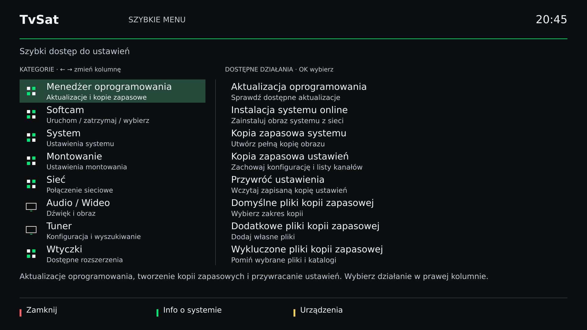
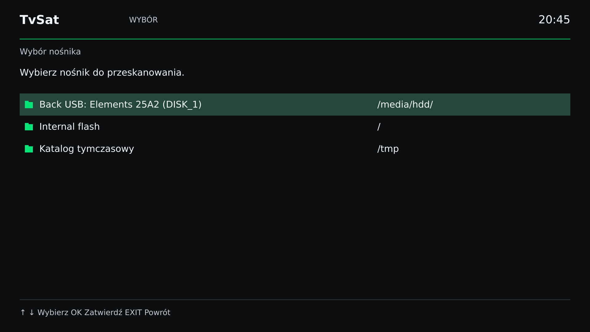

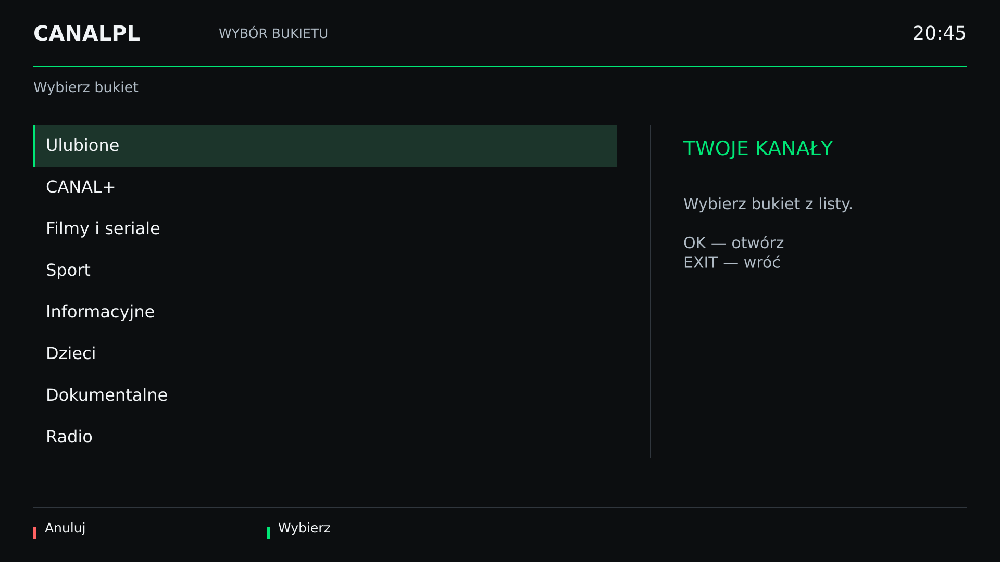


## Co obejmuje

- Menu główne, QuickMenu z niebieskiego przycisku, podmenu i opisy.
- Lista kanałów i radia, wybór bukietów i wariant z podglądem TV.
- Pikona bieżącego i zaznaczonego kanału; natywne pikony w liście i EPG.
- EPG pojedyncze, multi, graficzna siatka, PIG, szybkie i pionowe; bukiety w EPG.
- Opis audycji, programowanie nagrania, przegląd timerów.
- Lista nagrań, odtwarzacz, pauza/przewijanie i stan timeshiftu.
- Ustawienia, dźwięk/napisy, wtyczki lista/siatka i podstawowe okna dialogowe.
- Instalator IPK, stan instalacji, pobieranie/usuwanie pakietów, konsola i logi.
- FileCommander: dwa panele, menu operacji, informacje, podgląd i edytor plików.

Łącznie 62 definicje ekranów w każdym z dwóch wariantów. Specjalistyczne ekrany i zewnętrzne wtyczki mogą
korzystać z układu systemowego. Pełny zakres, źródła API i lista testów sprzętowych:
[COMPATIBILITY.md](docs/COMPATIBILITY.md).

## Instalacja `.ipk` — OpenATV

Pobierz [enigma2-plugin-skins-tvsat_0.6.3_all.ipk](packages/enigma2-plugin-skins-tvsat_0.6.3_all.ipk)
przyciskiem pobierania pliku na GitHubie. Prześlij go przez SFTP do `/tmp` dekodera:

```sh
opkg install /tmp/enigma2-plugin-skins-tvsat_0.6.3_all.ipk
```

Następnie wybierz **TvSat** w ustawieniach interfejsu / wyborze skórki i zatwierdź
restart GUI. Dokładne nazwy menu zależą od tłumaczenia i wydania OpenATV.
Pakiet nie przełącza skórki ani nie restartuje dekodera automatycznie.
Aktualizacjami i usuwaniem wersji `.ipk` zarządza `opkg`.

## Instalacja z terminala — również OpenATV 8.0

OpenATV 8.0 używa `opkg`. Paczka jest zgodna z formatem tego menedżera.

Instalacja paczki z GitHuba:

```sh
wget -O /tmp/TvSat-0.6.3.ipk https://raw.githubusercontent.com/Baniak88/enigma2-skin/main/packages/enigma2-plugin-skins-tvsat_0.6.3_all.ipk &&
opkg install /tmp/TvSat-0.6.3.ipk
```

Jeśli instalacja pakietu nie powiodła się i TvSat nie widnieje jako zainstalowana
paczka w `opkg`, można użyć instalacji ręcznej opisanej niżej. Pobiera ona komplet
plików i omija obsługę `.ipk`. Nie potwierdza to działania GUI na danym sprzęcie.
Nie uruchamiaj aktualizacji całego systemu ani opcji wymuszających zależności,
żeby naprawić błąd jednej skórki. Zachowaj dokładny komunikat z terminala.

## Pikony — poprawka 0.2.2

Usunięto zasłanianie pikon przez tło panelu. Enigma2 tworzy dekoracje po
rendererach, dlatego teraz logo ma wyższą warstwę niż grafika zastępcza.
Poprawka dotyczy paska informacji, panelu wybranego kanału i ekranów EPG
korzystających z renderera `Picon`. Obsługa pikonów wewnątrz natywnej listy
kanałów nie została zmieniona.

Jeśli logotypy działały na poprzedniej skórce, aktualizacja zachowa korzystanie
z istniejącej paczki i ustawień OpenATV. Po aktualizacji wykonaj restart GUI.
Jeżeli logo kanału nie zostanie znalezione, pozostaje neutralne pole bez symboli.

## Pikony i lista kanałów

1. Zainstaluj swoją paczkę pikonów zgodną z listą kanałów. Typowe katalogi:
   `/usr/share/enigma2/picon/`, `/media/usb/picon/`, `/media/hdd/picon/`.
   OpenATV wykrywa katalogi `picon` na zamontowanych nośnikach.
2. Włącz wyświetlanie pikonów w ustawieniach interfejsu i listy kanałów.
3. W ustawieniach listy kanałów wybierz styl ekranu **TvSat — podgląd TV** i szablon
   listy **TvSat**, następnie włącz pikony. Są to natywne ustawienia OpenATV.
   Po zmianie skórki ustawienia mogą wymagać ponownego wybrania.
4. Jeśli używasz trybu Legacy, włącz jego oddzielne ustawienie pikonów listy.

Logotypy stacji nie są dołączone. Skórka korzysta z natywnego renderera `Picon`
i wyszukiwania po referencji/nazwie kanału. Brakujący plik nie wymaga pobierania
z internetu; w pasku i panelu kanału pozostanie neutralne tło.
Wiersze natywnej listy mogą pozostawić puste miejsce przy braku logo.

Bukiety w liście kanałów otwierasz **niebieskim klawiszem**. Nie trzeba instalować
wtyczki do obsługi bukietów. Skórka nie tworzy ani nie modyfikuje list kanałów.

## EPG

Wybierz preferowany typ przewodnika w ustawieniach EPG OpenATV. Obsługiwane są
zarówno siatka z kolorami, jak i tryb graficzny z teksturami. Kolorowe przyciski
pobierają etykiety i funkcje z systemu. Rozkład przycisków zależy od ustawień pilota.
Pikony w siatce włączasz w ustawieniu sposobu wyświetlania nazw/pikonów kanałów.
Wariant PIG wymaga obsługi podglądu obrazu przez dekoder. Skórka nie dostarcza
danych EPG — pochodzą one z kanału lub skonfigurowanego przez użytkownika źródła.

## Alternatywna instalacja `.tar.gz` lub SFTP

Pobierz [TvSat-0.6.3.tar.gz](packages/TvSat-0.6.3.tar.gz), prześlij do `/tmp`:

```sh
mkdir -p /tmp/tvsat-install
cd /tmp/tvsat-install
tar -xzf /tmp/TvSat-0.6.3.tar.gz
sh install.sh
```

Instalator kopiuje TvSat, TvSatLarge oraz własne moduły z runtime do
`/usr/lib/enigma2/python/`. Przy aktualizacji zachowuje kopie poprzednich plików.
Jeśli zapis się nie powiedzie, przywraca już zastąpione pliki. Nie zmienia ustawień
użytkownika. Archiwum `.tar.gz` nie jest paczką `opkg`. SFTP służy do przesłania
całego archiwum i uruchomienia install.sh; samo skin.xml ani sam katalog TvSat
nie wystarczą. Nie mieszaj instalacji ręcznej i opkg.

## Powrót do poprzedniej skórki

W menu wybierz poprzednią skórkę i zrestartuj GUI. Jeżeli GUI nie startuje,
zaloguj się przez SSH, zatrzymaj je (`init 4` w obrazach z runlevel), zachowaj
kopię `/etc/enigma2/settings` i usuń z niego wyłącznie wiersz:

```text
config.skin.primary_skin=TvSat/skin.xml
```

Uruchom GUI (`init 3` w obrazach z runlevel). Zostanie wybrana skórka domyślna.
W obrazach z innym menedżerem usług zastosuj właściwą procedurę restartu GUI.

## Rozwój i kontrole

Python 3.12+. Budowanie i kontrola struktury paczek nie wymagają dodatkowych bibliotek.
Test podglądu PNG wymaga Pillow (`python3 -m pip install Pillow==11.3.0`):

```sh
python3 scripts/generate_skin.py
python3 scripts/build_assets.py
python3 scripts/validate.py
python3 scripts/check_upstream_skinselection.py --download
python3 scripts/check_upstream_service_ui.py --download
python3 scripts/check_upstream_fonts.py --download
python3 scripts/check_upstream_install_ui.py --download
python3 scripts/check_upstream_filecommander.py --download
python3 scripts/preview.py
python3 scripts/build.py
python3 -m unittest discover -s tests -v
```

Pliki wynikowe trafiają do `dist/`. Generowanie podglądów PNG wymaga opcjonalnego
Pillow: `python3 scripts/preview.py --png --thumbnail`. Podglądy SVG nie wymagają Pillow.
Testy sprawdzają strukturę `.ipk`, kompletność plików, instalację i kopię aktualizacji.
Walidator porównuje widgety z zapisanymi kontraktami oficjalnego kodu OpenATV.
GitHub Actions generuje pliki, wykonuje testy i buduje paczki. Po udanym teście
na głównej gałęzi zapisuje wynikowe pliki skórki, podglądy i paczki w repozytorium.
Publikacja nie jest wykonywana dla pull requestów. To kontrole
statyczne/integracyjne, a nie test uruchomienia GUI Enigma2.

Do zgłoszenia problemu dołącz model dekodera, wersję OpenATV, nazwę ekranu i log
błędu. Pliki i grafiki TvSat: MIT. Nazwa CANAL+ należy do jej właściciela.
